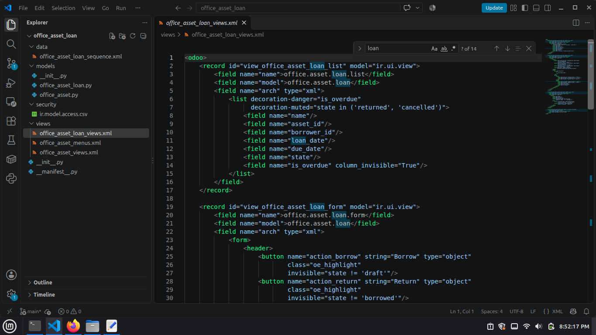
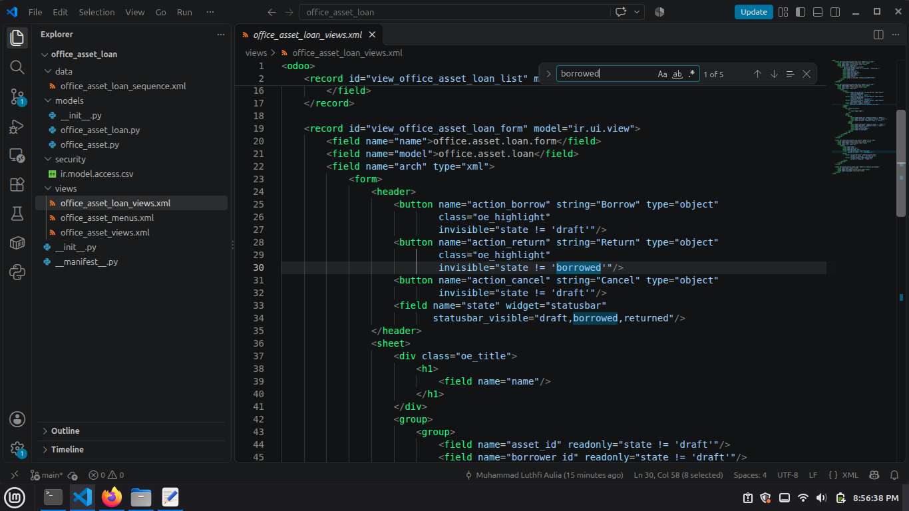
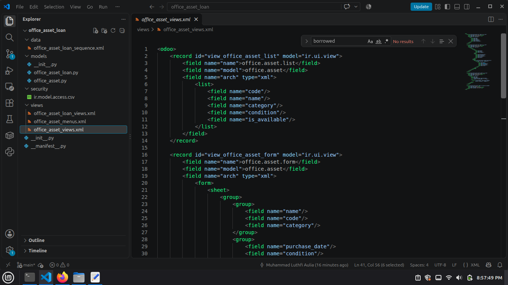

# Office Asset Loan

Custom module for **Odoo Community Edition 19.0** to record shared office
assets (projector, spare laptop, camera, etc.) and who borrows them.

Author: Muhammad Luthfi Aulia

## Features
- Asset inventory with unique asset code, category, condition and archive support
- Loan records with automatic numbering (`LOAN/0001`, `LOAN/0002`, ...)
- Borrow / Return / Cancel workflow with validation
- Prevents borrowing an asset that is already borrowed or damaged
- Due date validation and automatic due date suggestion (loan date + 7 days)
- Overdue loans highlighted in red; finished loans are greyed out
- Loan history tab on every asset
- Access rights for Internal Users

## Installation

### Via command line
1. Put the `office_asset_loan` folder in a directory listed in `addons_path`.
2. Create a new database and install the module:
   ```
   odoo-bin -c odoo.conf -d <new_db> -i office_asset_loan --stop-after-init
   ```

### Via UI
1. Restart Odoo, then enable Developer Mode.
2. Go to **Apps > Update Apps List**.
3. Search for **Office Asset Loan** and click **Install**.

## Odoo version
Odoo Community Edition 19.0

## Screenshots

### Loan List View


### Borrowed Loan Form View


### Asset Form View

